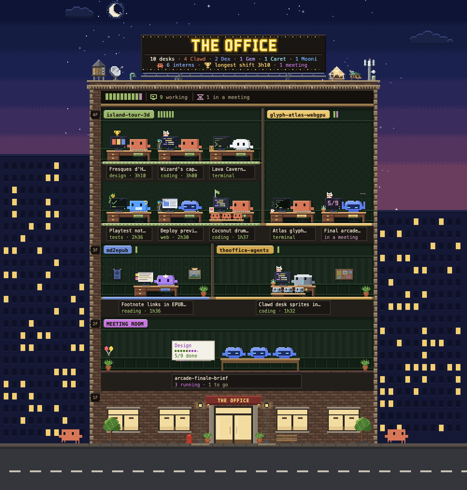
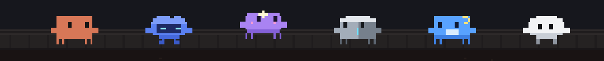
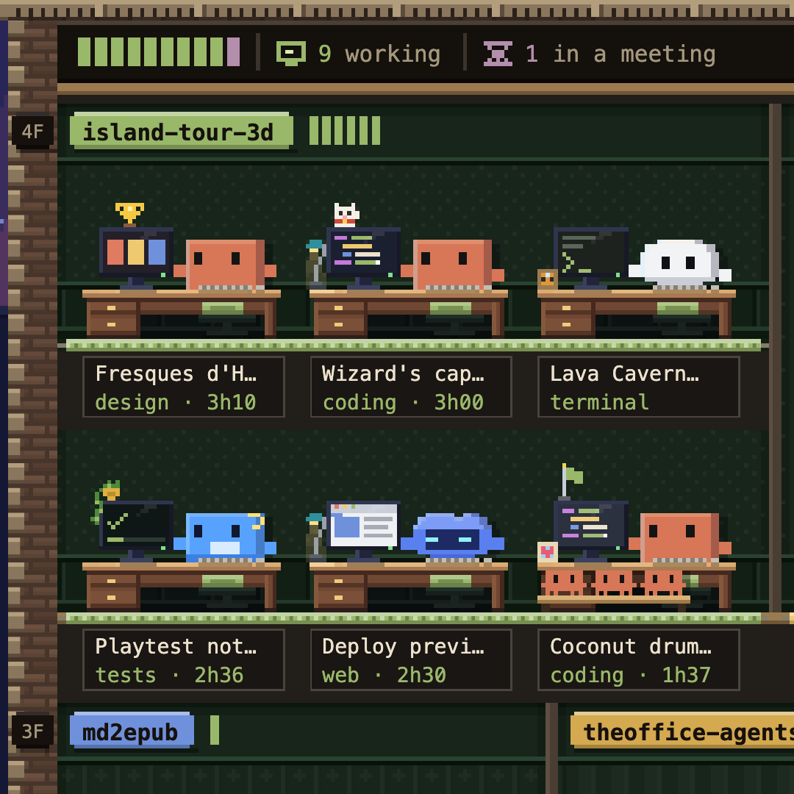
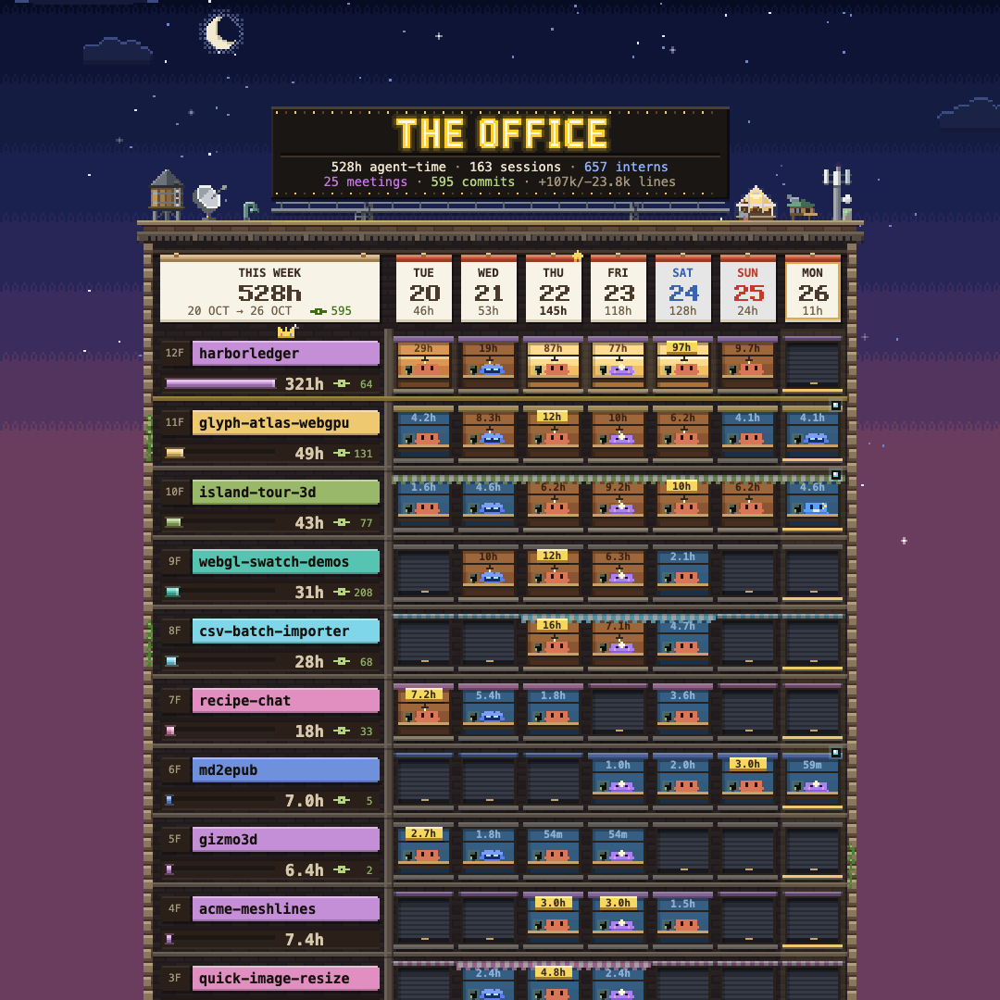
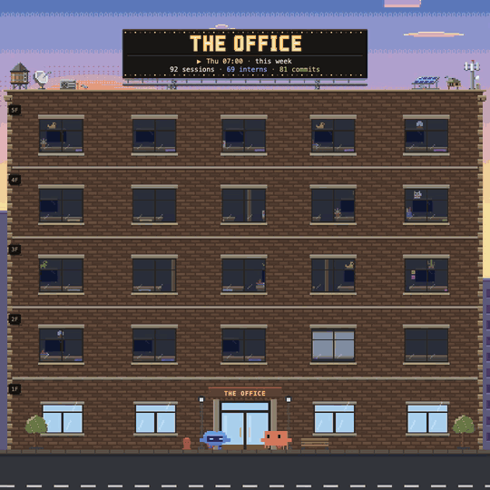

<div align="center">

# 🏢 The Office

**Your AI agents have an office now.**

A pixel-art building where every coding agent gets a desk, a character and a nameplate,<br>
open right beside your chat in Claude Code.



[Website](https://theoffice.makio.io) · [Install](#move-in) · [Full guide](docs/guide.md)

</div>

Ever wonder what your agents are actually up to? Peek in. Clawd is typing away in `island-tour-3d`, three interns are squeezed onto Dex's bench, a workflow has taken over the meeting room again, and somebody has a hand up, waiting on *you*. Scroll down and the week turns into a tower, the month into a wall calendar, and the whole thing replays as a timelapse.

It reads the files your agents already write. Nothing leaves your machine.

## Meet the cast



| Agent | Character | Personality |
| --- | --- | --- |
| Claude Code | **Clawd** | the first tenant: careful, polite, asks before it breaks anything |
| Codex | **Dex** | runs every command itself, patches in tidy diffs |
| Gemini / Antigravity | **Gem** | a twin-star dreamer: reads the whole repo in one go |
| Cursor | **Caret** | finishes your sentences: tab, tab, tab |
| Kimi | **Mooni** | a night owl from the moon: reads the longest docs |
| Grok | **Rok** | cracks a joke first, keeps its towel handy |

Subagents are **interns**, workflows hold **meetings**, and every account you use (`~/.claude`, `~/.claude-work`, `~/.codex`…) moves into the same building.

## Move in

In Claude Code in a terminal:

```
/plugin install theoffice --marketplace Makio64/theoffice-agents
```

In the desktop app, paste this into the chat and let Claude run it:

```text
Install The Office for me by following https://theoffice.makio.io/install.md
```

Or by hand: **+** next to the prompt → **Plugins** → **Add** → **Add marketplace** `Makio64/theoffice-agents`, then search **office** in the plugins and switch **The Office** on.

Then start a new session and type `/theoffice`. You need Node.js 24+ and Claude Code 2.1.308+; there's nothing to `npm install`.

## Look around

`/theoffice` opens the pane (and closes it again). Six tabs, one key each:

| Key | Tab | What you get |
| --- | --- | --- |
| `1` | **Live** | who's at a desk right now, floor by floor |
| `2` | **Today** | today's time clock, hour by hour |
| `3` | **Week** | the tower: a floor per project, a window per day |
| `4` | **Month** | the wall calendar and the building directory |
| `5` | **What they did** | the departments: coding, testing, reading, browsing… |
| `6` | **Timelapse** | yesterday, the week or the month on fast-forward |

<table>
<tr>
<td width="33%"></td>
<td width="33%"></td>
<td width="33%"></td>
</tr>
<tr>
<td><sub><b>Live</b>: who's typing, testing or stuck</sub></td>
<td><sub><b>Week</b>: which projects got the hours</sub></td>
<td><sub><b>Timelapse</b>: desks fill at dawn, lights out at night</sub></td>
</tr>
</table>

**Reading the room:** a raised hand ✋ means it's waiting on you · a ✓ on its screen means done, your turn · mug in hand in the kitchen means a break until its background job reports back · a coat on the rack means it just went home.

`q` takes the words off (Quiet), `z` zooms in, and the ◀ ▶ strip pages back through the past, as far as you like. Or just ask Claude: *"what are my agents doing?"*, *"show me this week's tower"*.

## Not on Claude Code?

The same office runs in **Cursor**, **Antigravity** and **Codex** (build it with `npm run package:plugin`), as an editor pane (`npm run package:editor`), or in any browser:

```bash
npm run dashboard
```

It even plays in your terminal, Clawds typing and monitors flickering:

```bash
node plugin/scripts/office.mjs live --watch
```

Setup for each host, every flag and export, and how the collector works: **[the full guide](docs/guide.md)**.

## Privacy

- **Read-only.** It never touches your sessions or settings, and never opens a credential file.
- **Local.** No network, no uploads, no telemetry.
- **Discreet.** It shows titles, project names and tool counts, with secrets redacted from titles. Prompts and file contents are never shown.

## Hack on it

```bash
npm test     # the node tests
pnpm dev     # load the plugin from this folder for one session
pnpm site    # draw and serve the website
```

## License

MIT © Makio64 (David Ronai)
