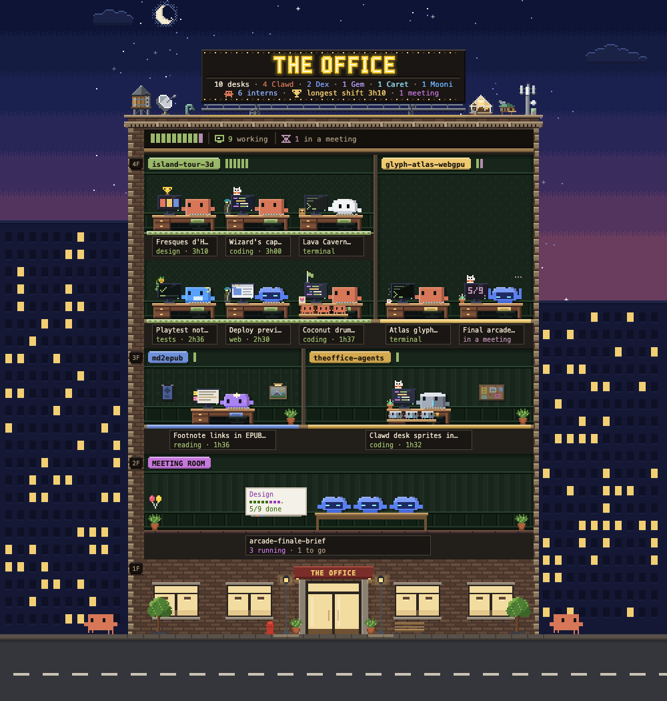
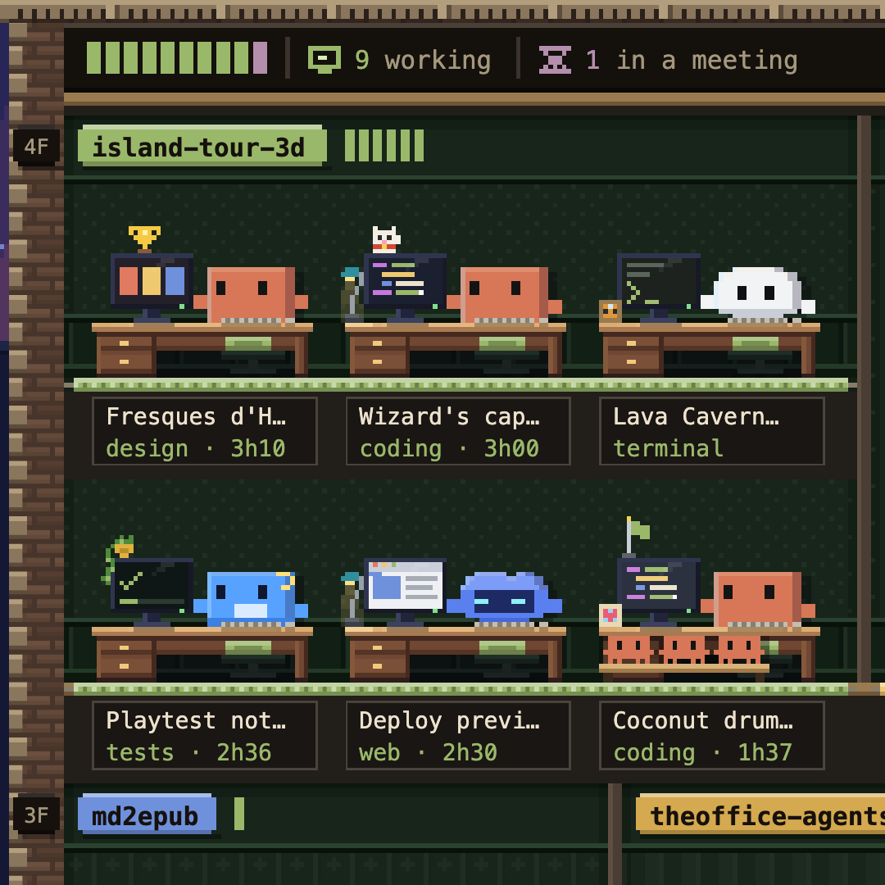
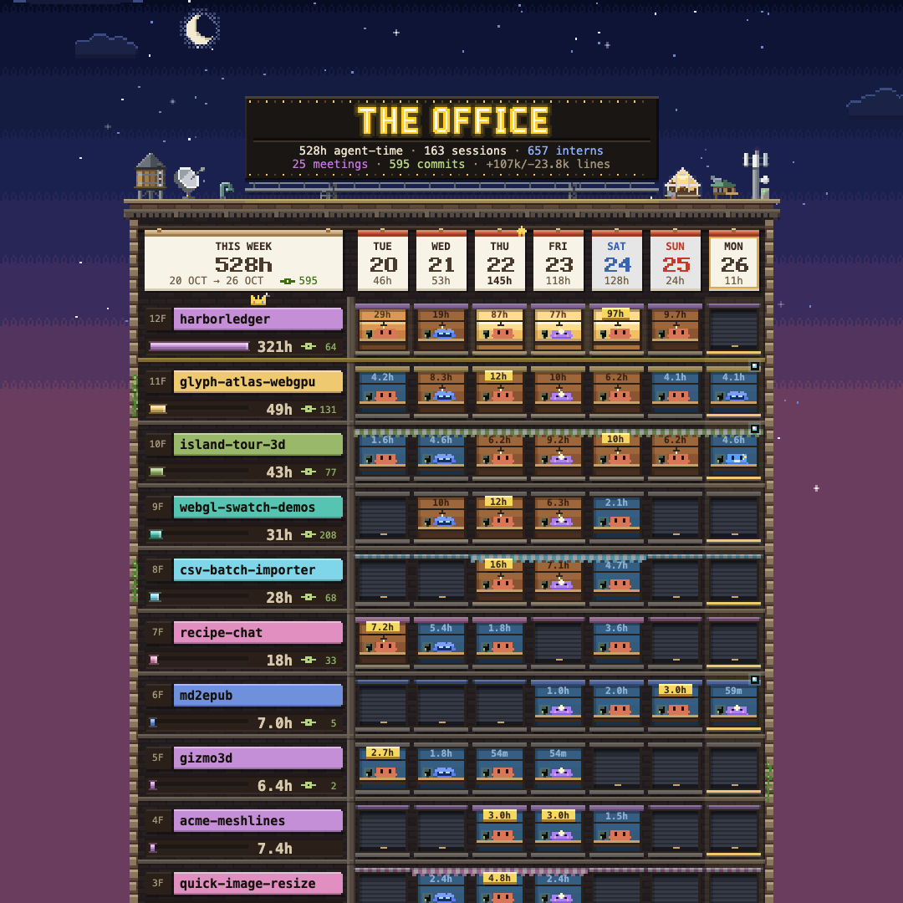
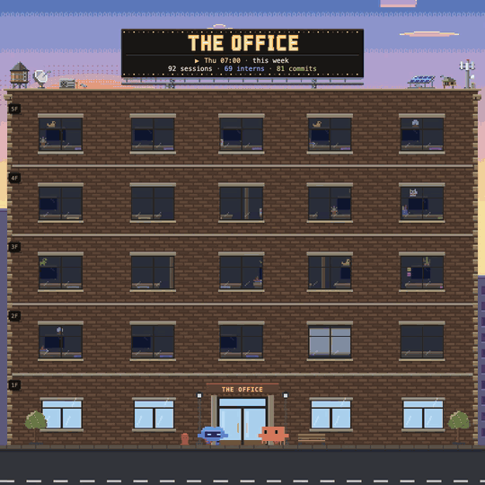

# 🏢 The Office

**Your AI agents have an office now.**



A live dashboard of every coding agent you run, drawn as a pixel-art building where each one gets a desk, a character and a nameplate, right beside your chat in Claude Code. Spot the agent waiting on you, see which projects got the hours, and catch up on what got done today, this week or this month, across Claude Code, Codex, Gemini, Cursor and every account you use.

Ever wonder what your agents are actually up to? Peek in. Clawd is typing away in one project, three interns are squeezed onto Dex's bench, a workflow has taken over the meeting room again, and somebody has a hand up, waiting on *you*. Page back and the week turns into a tower, the month into a wall calendar, and the whole thing replays as a timelapse.

It reads the files your agents already write. Nothing leaves your machine.

## Meet the cast

Every account you use moves into the same building, each agent as its own character:

| Agent | Character |
| --- | --- |
| Claude Code | **Clawd**, the first tenant: careful, polite, asks before it breaks anything |
| Codex | **Dex**, runs every command itself, patches in tidy diffs |
| Gemini / Antigravity | **Gem**, a twin-star dreamer: reads the whole repo in one go |
| Cursor | **Caret**, finishes your sentences: tab, tab, tab |
| Kimi | **Mooni**, a night owl from the moon: reads the longest docs |
| Grok | **Rok**, cracks a joke first, keeps its towel handy |

Subagents are **interns** and workflows hold **meetings**.

## Look around

Type `/theoffice` to open the pane beside the chat (and again to close it; in a terminal it opens in your browser), or just ask Claude: *"what are my agents doing?"*, *"show me this week's tower"*. Six tabs, one key each:

| Key | Tab | What you get |
| --- | --- | --- |
| `1` | **Live** | who's at a desk right now, floor by floor |
| `2` | **Today** | today's time clock, hour by hour |
| `3` | **Week** | the tower: a floor per project, a window per day |
| `4` | **Month** | the wall calendar and the building directory |
| `5` | **What they did** | the departments: coding, testing, reading, browsing… |
| `6` | **Timelapse** | yesterday, the week or the month on fast-forward |

<table>
<tr>
<td width="33%"></td>
<td width="33%"></td>
<td width="33%"></td>
</tr>
</table>

**Reading the room:** a raised hand ✋ means it's waiting on you · a ✓ on its screen means done, your turn · a mug in the kitchen means a break until its background job reports back · a coat on the rack means it just went home. `q` takes the words off, `z` zooms in, and the ◀ ▶ strip pages back through the past.

**In a terminal**, `/theoffice` (or a tab's name after it, or **🏢 Open The Office** above the prompt) opens The Office in your browser: the same pixel art, menu and keys as the desktop app's pane, redrawn as your agents work. `/theoffice browser` does the same from the desktop app.

**On a screen of its own**, a tablet on a stand, a picture frame with a browser or a spare monitor, The Office runs full screen without Claude open. Press the **Frame** key at the right end of the pane's menu (the little screen, or `f`), then **Turn on**: the pane shows a QR code and an address for the screen to open. `/theoffice frame` opens the same panel, `/theoffice frame on` turns it on from the prompt (in a terminal it prints the address and the code), `off` turns it off and `new` replaces its link. Outside Claude it is one command:

```
node <plugin>/scripts/dashboard.mjs --frame --detach
```

The page is the drawing alone, in the screen's own shape, held wide or upright (upright, the Month hangs its calendar over its directory), redrawn as your agents work. A tap brings up the tabs as a bar of keys (Live, Today, Week, Month, What they did), a swipe turns them, `&rotate=5` on the address turns them every five minutes, and `&smooth=1` makes the animation glide instead of stepping. The address stays the same across restarts, and the frame shows **Closed** while your computer sleeps. On an iPad, **Share → Add to Home Screen** hides Safari's bars. `--frame --stop` stops it, `--frame --new-link` replaces the address, `--frame --local` keeps it on this computer to try it first. See what it opens on your network under *What it does on your computer*.

## Install

In Claude Code in a terminal:

```
/plugin install theoffice --marketplace Makio64/theoffice-agents
```

In the desktop app, paste this into the chat and let Claude run it:

```text
Install The Office for me by following https://theoffice.makio.io/install.md
```

Or by hand: **+** next to the prompt → **Plugins** → **Add** → **Add marketplace** `Makio64/theoffice-agents`, then search **office** in the plugins and switch **The Office** on.

Then start a new session and type `/theoffice`.

## What you need

- **Claude Code 2.1.308 or newer**: in a terminal, in the desktop app's Code tab, or in the VS Code chat panel.
- **Node.js 24 or newer** on your `PATH`: the pane runs its collector with `node`. There is nothing to `npm install`.

## What it does on your computer

Everything The Office runs, reads and writes, so you can decide before you install it:

- **Opens a pane** beside the chat (a desktop mod, `hooks/register.tsx`) and keeps a short headcount, such as `5 working · 1 hand up`, in the status line.
- **Runs one local program**, `node scripts/office.mjs`, which reads your agents' activity and draws it. While a Claude Code session is open it runs about once a minute for the status line, more often while the pane is on screen, and when you ask Claude for a view (the `office` skill). Every session on the computer shares one run. The exact commands are listed below.
- **Reads your agents' session files, read-only:** `~/.claude` and each `~/.claude-<name>` account (Claude Code), `~/.codex` (Codex), `~/.gemini` (Gemini CLI and Antigravity), `~/.cursor/projects` (Cursor), `~/.kimi-code` and `~/.kimi` (Kimi), `~/.grok` (Grok). It never opens a credential file (`auth.json`, OAuth tokens, `.key` files) or a database, and never changes your sessions or settings.
- **Runs `git`, read-only,** in the projects it finds (`git config user.email`, `git log`, `git show --numstat`) to count your own commits. `THEOFFICE_NO_GIT=1` turns it off.
- **Asks [novibenolife](https://novibenolife.com), if you have it,** about the agents it has no reader for (`novi <range> --facts --no-ingest`). `THEOFFICE_NO_NOVI=1` turns it off.
- **Writes only its own cache:** the plugin data folder Claude Code gives it (under `~/.claude/plugins/data/`), else `~/.cache/theoffice/`, readable by you only. Drawings and exports you ask for (a timelapse, a month calendar) go in that cache's `pixel/` folder.
- **Plays one sound**, a page turn, when you switch tabs or pages.
- **Opens a browser page only when you ask** (`/theoffice browser`, the terminal pane's **⧉ Browser** key, an export with *open*, or the dashboard): a local server on `127.0.0.1` with a random access token. One such server runs per computer: while it runs its address is kept in the cache (`dashboard-ready.json`, readable by you only) so the next open reuses it, and it stops by itself half an hour after its last page closes. While a page is open, the server looks every second and a half at your Claude sessions' records (`~/.claude/sessions/*.json`, which say a session's status) and at the size and time of their transcripts and of the other agents' session files, to know when to redraw. It reads no transcript's contents for that.
- **Listens on your network only if you turn a frame on yourself** (the Frame key's **Turn on**, `/theoffice frame on`, or `node scripts/dashboard.mjs --frame`; opening the Frame's panel only asks whether one runs, and nothing else ever starts it): a second server, on port 3375 or the next free one, that other devices on your network can reach, so a tablet or a picture frame can show the office. It answers one link, with a random token of its own kept in `~/.cache/theoffice/frame.json` (readable by you only; one place for the computer, so the pane, the skill and a terminal all find the same frame) so the screen's address stays good across restarts. That link only looks: it gets the frame's page, the drawings of now (project names, session titles, what each agent is doing) and the signal that they changed; it cannot turn the calendar's pages, export, change a setting or stop the server, and the browser page's own link is refused from any other device. The page travels over your network unencrypted, so anyone on it who has the link sees what the frame shows: use it on a network you trust, and `--frame --new-link` if the link got out. It runs until you stop it (`--frame --stop`) or the computer restarts.
- **Sends nothing.** No network requests, no uploads, no telemetry.

### The programs the pane runs

The pane runs only `node`, on the plugin's own script, through Claude Code's `$.process.run`. Node reads the session folders above far faster than the mod can, and keeps that work out of Claude Code's own process. `<plugin>` is the plugin's install folder.

| When | Command |
| --- | --- |
| The live office and the status line (about once a minute, every few seconds while the pane is on screen) | `node <plugin>/scripts/office.mjs all --json --since <time>` |
| The first drawing while the cache is still being built | `node <plugin>/scripts/office.mjs all --json --first-light` |
| The Today and Month tabs | `node <plugin>/scripts/office.mjs today --json --since <time>`, `… month --json --since <time>` |
| A page of the past (the ◀ ▶ strip) | `node <plugin>/scripts/office.mjs <today\|week\|month> --back <N> --json --since <time>` |
| The Timelapse tab | `node <plugin>/scripts/office.mjs timelapse <yesterday\|week\|month> --json` |
| You press Export on the Timelapse | `node <plugin>/scripts/office.mjs timelapse <range> --export --open` |
| You press Export on the Month | `node <plugin>/scripts/office.mjs month [--back <N>] --export <calendar\|directory\|whole\|stats> --as <png\|svg\|gif\|video\|html\|csv\|json> --open [--stdin]` |
| You open The Office in a terminal (`/theoffice [tab]`, **🏢 Open The Office**), or type `/theoffice browser [tab]` | `node <plugin>/scripts/dashboard.mjs --detach --reuse --open --view <tab> [--back <N>] [--range <range>] [--quiet] [--zoom]` |
| You press the Frame key, or type `/theoffice frame`: is a frame running? (starts nothing) | `node <plugin>/scripts/dashboard.mjs --frame --status --json` |
| You press **Turn on** in the Frame's row, or type `/theoffice frame on` | `node <plugin>/scripts/dashboard.mjs --frame --detach --json` |
| You press **New link**, or type `/theoffice frame new` | `node <plugin>/scripts/dashboard.mjs --frame --detach --new-link --json` |
| You press **Turn off**, or type `/theoffice frame off` | `node <plugin>/scripts/dashboard.mjs --frame --stop --json` |

`office.mjs` itself runs `git` and `novi` as described above, and an export's `--open` hands the saved file to your system's opener (`open` on macOS, `xdg-open` on Linux, `start` on Windows), which shows it in your browser. `dashboard.mjs` starts the local server in the background (or finds the one already running), hands its page's address to the same opener, and prints that address. With `--frame` it starts, finds or stops the frame's server instead and answers where it stands in one line (whether it runs, and its addresses), which the pane checks before it draws any of it.

### What goes where

The mod reads local files with `$.fs.read` (its own cache and the times your session folders changed) and its only way out is `$.process.run`, which starts `node` on the plugin's own `scripts/office.mjs` (or `scripts/dashboard.mjs`, for the browser and the frame) with the commands above. Nothing it reads, and nothing from your conversation (its `prompt.submit` hook never reads the prompt), goes anywhere but that script, and the script sends nothing off your computer.

- **To its own script, nothing else:** the arguments above and, for a Month export with `--stdin`, the month's activity the pane already shows, on the script's standard input, so the file matches the screen. The script writes the export into the plugin's cache folder.
- **Back to the pane:** the script's answer (activity counts, session titles, project names) as JSON on its standard output.
- **Nowhere off your computer.** The browser pages (the dashboard, the exports) load only from the plugin's own server on `127.0.0.1`. The access token in their address is random, made fresh by the plugin each time; it is never read from your environment or from any credential. The one way out is a frame you start yourself (above): its page goes to the screens on your network that you gave its link to, and no further.

The pane also reads, with Claude Code's own file calls (`$.fs`), the collector's answers in its cache folder and the modification times of your agents' session folders, so it can tell when to look again.

### What each hook does

- `session.start`, `session.attach`: registers `/theoffice`, restores the pane's last tab and settings, and starts its timers.
- `prompt.submit`, `turn.complete`: ask the pane to look for new activity a moment later. They never read your prompt or Claude's reply, and pass both on unchanged.
- `command.run` (`/theoffice`): opens or closes the pane; in a terminal, or with `browser`, opens The Office in your browser instead; with `frame`, shows where the frame stands, and turns it on, off or gives it a new link only with `on`, `off` or `new` after it.
- `ui.render`: draws the pane, and the **🏢 Open The Office** button above the prompt while the pane is closed.
- `ui.message`: a click on the pixel menu (`hooks/menu.tsx`: the tabs, the switches, the Frame's row) or the page strip (`hooks/period.tsx`), the two small views drawn inside the pane.
- `ui.close`: notes that you closed the pane.

### Two files that aren't code

- `sounds/page.mp3`: the page-turn sound the pane plays with Claude Code's `$.audio.play` when you switch tabs or pages. Nothing runs it.
- `assets/icon.png`: the plugin's icon.

## Privacy

The office shows session titles, project names, tool names and counts. Titles pass through secret redaction first. Prompt text, file contents and account ids are never shown, and nothing leaves your machine.

## More

- Website: <https://theoffice.makio.io>
- Every view, flag and export, and how the collector works: [the full guide](https://github.com/Makio64/theoffice-agents/blob/main/docs/guide.md)
- Questions and bugs: [GitHub issues](https://github.com/Makio64/theoffice-agents/issues)

MIT © Makio64 (David Ronai)
